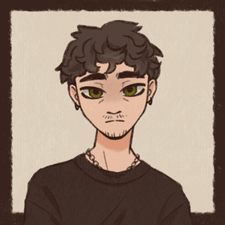
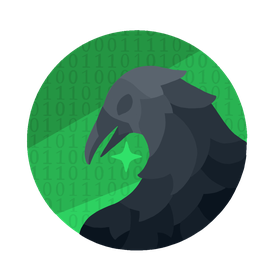

# Pedro Ross

**`Full-Stack Developer | Founder @ LaborWaze`**

I'm Pedro Henrique Rodrigues Ross, a full-stack developer from São Paulo, Brazil. I build web and mobile apps, from the interface to the API and the database, mostly with React, React Native, Next.js, Node.js and NestJS.

I founded **LaborWaze**, a technology company where we build complete systems and record how they are made, from the technical decisions to the problems along the way, on our [YouTube channel](https://www.youtube.com/@LaborWaze). Projects and professional updates also go on my [LinkedIn](https://www.linkedin.com/in/pedro-ross).

---

  &nbsp;
  &nbsp;
  &nbsp;
  &nbsp;
  &nbsp;
  &nbsp;
  &nbsp;
  &nbsp;
  &nbsp;
  &nbsp;
  &nbsp;
  &nbsp;
  &nbsp;
  

---

## Featured projects

| Project | What it is | Built with |
|---|---|---|
| [Colégio Aquarela](https://github.com/PedroRossZny/colegio-aquarela) | Website for a school in Guaíra/SP, made for the client. [Live site](https://www.colegioaquarelaguaira.com.br) | HTML, Sass, GSAP, Vite |
| [Painel de Chamadas](https://github.com/PedroRossZny/painel-chamadas) | Patient call system for health units, with a TV panel that reads each call aloud. Made with [Caique](https://github.com/Caique7k). [Video](https://youtu.be/C7DnWuI7jQk) | Next.js, NestJS, PostgreSQL |
| [Avalia Aqui](https://github.com/PedroRossZny/avalia-aqui) | Site to rate local places, with a ranking and anonymous comments. [Live demo](https://avalia-aqui.vercel.app), [video](https://youtu.be/7NlSEaWKleI) | Node.js, Express, SQLite |
| [Smoke Coffee](https://github.com/PedroRossZny/smoke-coffee) | Coffee shop ordering app with menu, cart and Pix or card checkout | React Native, Expo |
| [SpaceX Launches](https://github.com/PedroRossZny/spacex-launches) | Recent SpaceX launches with search and favorites, from the Launch Library 2 API | React Native, Expo |
| [S.O.S Ambiente](https://github.com/PedroRossZny/sos-ambiente) | App to log eco-friendly actions and estimate CO₂ emissions | React Native, Expo |
| [Lost Memories](https://github.com/PedroRossZny/lost-memories) | Pixel-art game in progress, with art drawn by me | Python, pygame-ce |

Course work: [Python](https://github.com/PedroRossZny/python-studies) (all 115 challenges), [HTML and CSS](https://github.com/PedroRossZny/html-css) ([pages online](https://pedrorosszny.github.io/html-css/)) and [JavaScript](https://github.com/PedroRossZny/javascript-studies), from Curso em Vídeo.

## Personal links

  

  

## LaborWaze

  

  

---

<picture>
  <source media="(prefers-color-scheme: dark)" srcset="https://raw.githubusercontent.com/PedroRossZny/PedroRossZny/output/github-contribution-grid-snake-dark.svg">
  <source media="(prefers-color-scheme: light)" srcset="https://raw.githubusercontent.com/PedroRossZny/PedroRossZny/output/github-contribution-grid-snake.svg">
  
</picture>

